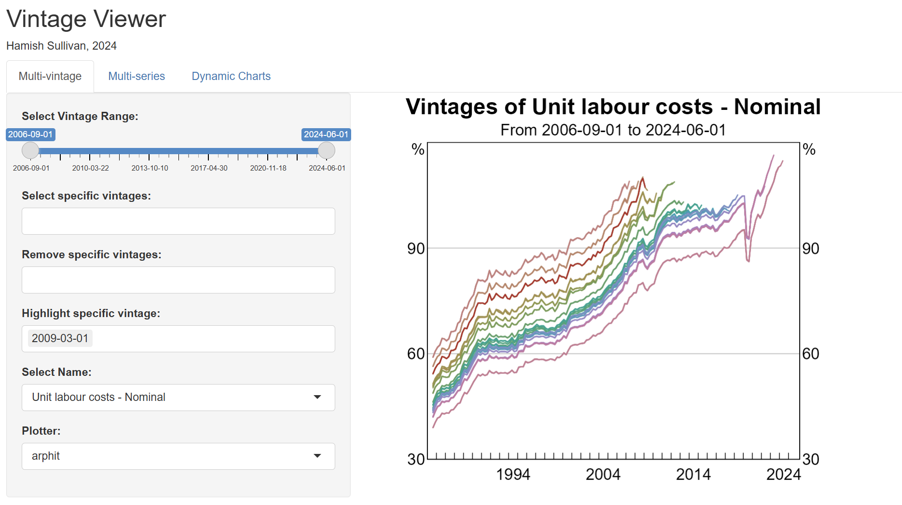
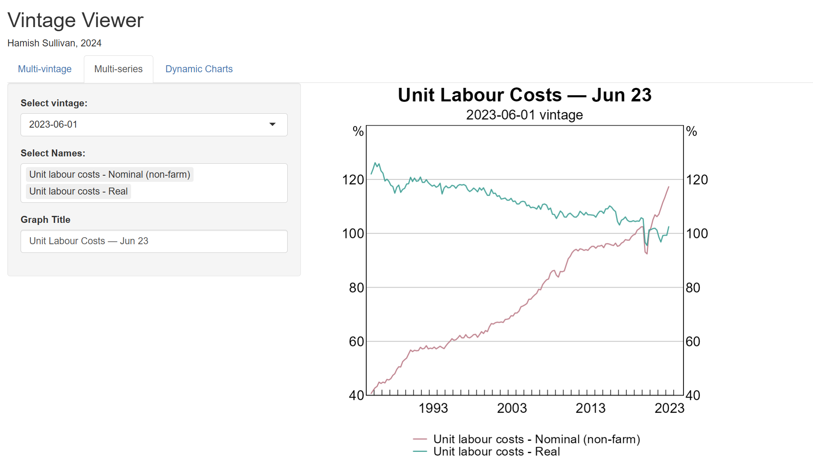
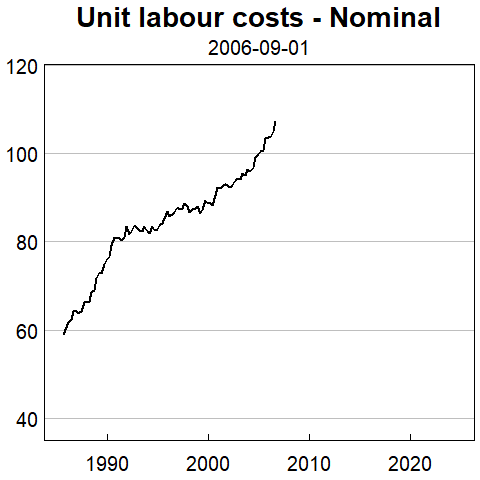

This software was built in 2024 for Sullivan and West forthcoming.

`timetravelr` is an R package containing tools to work with data vintages, source vintages from the ABS, and ‘send models and associated data pipelines back in time’.

See the [package vignette](vignettes/timetravelr.pdf) (or `vignette("timetravelr")`) for the full manual, including Pseudo-GERTRUDE usage.

## What can timetravelr do?
The package includes four main functionalities:

1.	**Vintage Viewer** 
An interactive ‘Vintage Viewer’ dashboard generates (static and dynamic) graphs of input data and output vintages, assisting with presentation of results and diagnosis of issues with particular vintages.

2.	**Run EViews scripts from R** 
Model scripts can be dynamically modified for each vintage; avoiding issues with hardcoded dates and other configuration which need to be modified dynamically. Vintages of EViews models can be run from R.

3. **An API for pulling vintages from ABS archives, and loading them into R**  
readabs only supports retrieving vintages of series back to 2019. timetravelr interfaces with legacy ABS release pages/servers and is able to retrieve and load-in vintages from 2006 to 2019, and provides a similar interface for pulling more recent vintages.

4. **Pseudo-GERTRUDE** 
Calls to `rGertrude` can be intercepted and dynamically replaced with the relevant vintage of data, allowing you to use your existing data pipelines with vintages without any modifications. See the vignette for details.

## Vintage Viewer

Working with large amounts of vintage data is hard. The timetravelr Vintage Viewer
allows you to explore an arbitrary dataframe of vintage data in a dashboard. 

Just pass a dataframe with the following columns to `timetravelr::vintage_viewer()`:

1. **Vintage**: Vintage date. 
2. **Date**: Observation date.
3. **Name**:  Variable name.
4. **Value**: Value of the variable.

The dashboard allows three types of charts. 

### Multi-vintage charts
Plot many vintages of a single variable over time. You can select the variable 
and vintages on the LHS panel. You can also highlight specific vintages in red. 

### Multi-series charts

Plot a single vintage of multiple series. 

### Dynamic charts

Create a .gif of which animates the vintages of a single variable over time. 

## Creating and running vintages of EViews Code from R

Use `create_scripts_for_vintages()` to generate EViews model scripts for each vintage from a template, or `create_prg()` to create a single .prg. Use `run_prg()` to run a single .prg file, or `run_prgs_for_vintages()` to run many. See the vignette for examples.

## APIs for downloading and loading in vintages

timetravelr provides an API to download and load in vintages from the ABS, as well as source the dates for which each vintage is published.

Use `ABS.find_files()`/`ABS.download_files()` for vintages prior to 2019, and `download_abs_vintages()` (via `readabs`) for later vintages; `get_abs_publication_dates()` sources the publication date of a given release. See the vignette for examples.

Downloading vintages from GERTRUDE is not yet supported; see the vignette for how to load in vintage files exported from GERTRUDE's web interface instead.

### Loading in vintages after they have been downloaded from the ABS or GERTRUDE
Vintages from the ABS or GERTRUDE can be easily loaded-in, using 
either the `read_absfiles` or `load_gert_vintages_long` functions respectively. 

## Pseudo-GERTRUDE

See the vignette for Pseudo-GERTRUDE documentation, including `mask_gertrude()`/`unmask_gertrude()`, the required `vintage_data` format, and the interpolation feature.

