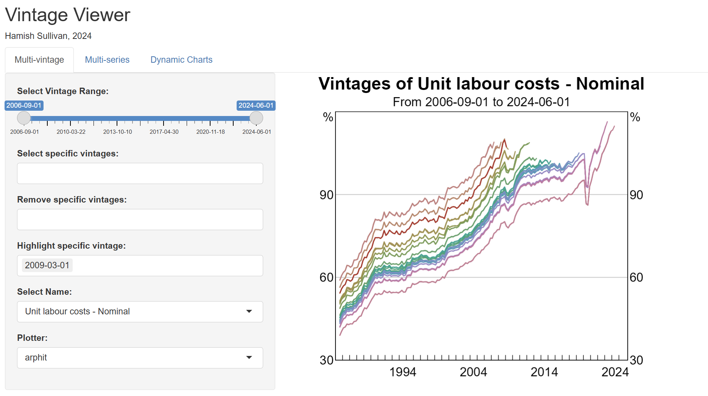
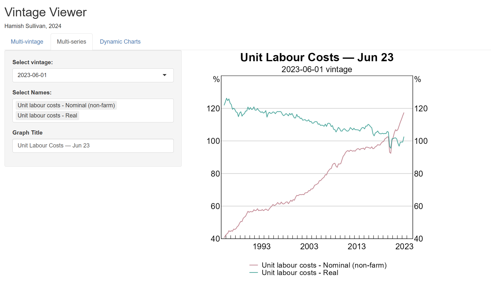
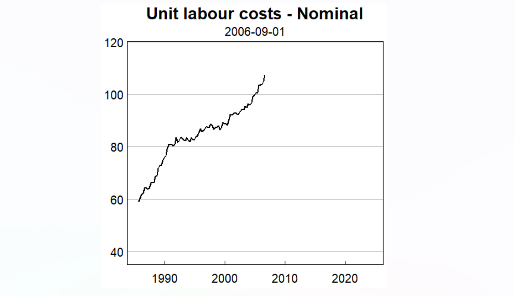
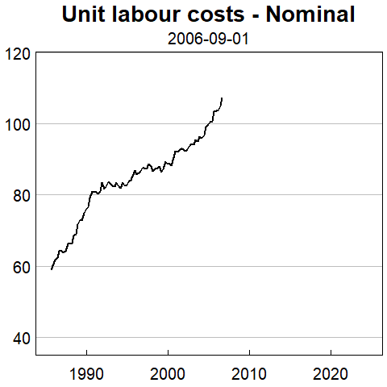

```{r setup, include=FALSE}
knitr::opts_chunk$set(echo = TRUE)
```

## Introduction
`timetravelr` is an R package containing tools to work with data vintages, source vintages from the ABS, and ‘send models and associated data pipelines back in time’. This software was built in 2024 for Sullivan and West forthcoming, but can be applied in other contexts.

## What can timetravelr do?
The package includes four main functionalities:

1.	**Vintage Viewer** 
An interactive ‘Vintage Viewer’ dashboard generates (static and dynamic) graphs of input data and output vintages, assisting with presentation of results and diagnosis of issues with particular vintages.
     
2.	**Run EViews scripts from R** 
Model scripts can be dynamically modified for each vintage; avoiding issues with hardcoded dates and other configuration which need to be modified dynamically. Vintages of EViews models can be run from R.   
    
3. **An API for pulling vintages from ABS archives, and loading them into R**  
readabs only supports retrieving vintages of series back to 2019.  timetravelr interfaces with legacy ABS release pages/servers and is able to retrieve and load-in vintages from 2006 to 2019, and provides a similar interface for pulling more recent vintages.

4. **Pseudo-GERTRUDE** 
Calls to `rGertrude` can be intercepted and dynamically replaced with the relevant vintage of data, allowing you to use your existing data pipelines with vintages without any modifications. 

## Vintage Viewer

Working with large amounts of vintage data is hard. The timetravelr Vintage Viewer
allows you to explore an arbitrary dataframe of vintage data in a dashboard. 

Just pass a dataframe with the following columns to `timetravelr::vintage_viewer()`:

1. **Vintage**: Vintage date. 
2. **Date**: Observation date.
3. **Name**:  Variable name.
4. **Value**: Value of the variable.

```{r pressure, eval=FALSE, echo=FALSE}
data
timetravelr::vintage_viewer(data)
```

The dashboard allows three types of charts. 

### Multi-vintage charts
Plot many vintages of a single variable over time. You can select the variable 
and vintages on the LHS panel. You can also highlight specific vintages in red. 



### Multi-series charts

Plot a single vintage of multiple series. 



### Dynamic charts

Create a .gif of which animates the vintages of a single variable over time. 

```{r, echo=FALSE, results='asis'}
if (knitr::is_latex_output()) {
    cat("{width=100%}")
} else {
  cat("")
}
```

## Creating and running vintages of EViews Code from R

### Creating custom model scripts
You can use the `create_scripts_for_vintages` function to generate EViews model scripts for different vintages of your data.
Parts of the template script can be customized to suit each vintage. 

For each vintage date, this creates a subdirectory of `output_dir`, copies `copy_files` from `template_dir` as-is, and copies `edit_prgs` with values substituted in via `params_generator` (a function of `vintage_date` and file name, returning a named list of replacements).

``` {r, eval=FALSE}
params_generator <- function(vintage_date, file_) list(VINTAGE_DATE = as.character(vintage_date))
create_scripts_for_vintages(vintage_dates = VINTAGE_DATES, template_dir = "./templates",
                            output_dir = "./output", copy_files = c("data.prg"),
                            edit_prgs = c("model.prg"), params_generator = params_generator)
```

If you want to create a single .prg, you can use the `create_prg` function directly. 
``` {r, eval=FALSE}
create_prg(template_path = "template.prg", params = list(VINTAGE_DATE = "2024-03-01"), save_path = "out.prg")
```

### Running .prg files
#### Single .prg file
The most basic function runs a single given .prg file. 
The function will switch the working directory,  run a .prg file, and switch back to the original working directory.
``` {r, eval=FALSE}
EviewsR::set_eviews_path("C:/Program Files/EViews 13/Eviews13.exe") # You only have to set this once.
run_prg(prg="test.prg", directory="./DIRECTORY_WITH_PRG")
```

#### Running multiple .prgs (presumably generated from create_scripts_for_vintages)
If you have a lot of different directories each with their own vintage/variant of the .prg file (for instance, as created by `create_scripts_for_vintages` above), you can use the `run_prgs_for_vintages` function to hop between the folders and run the script for each vintage.
``` {r, eval=FALSE}
prgs_to_run <- c("script1.prg", "script2.prg")
run_prgs_for_vintages(vintage_dates=VINTAGE_DATES, prg_files=prgs_to_run, output_dir="DIR_CONTAINING_VINTAGE_FOLDERS")
```

## APIs for downloading and loading in vintages

timetravelr provides an API to download and load in vintages from both the ABS, as well as source the dates for which each vintage is published.

### Downloading vintages from the ABS
#### Downloading vintages prior to 2019
For vintages prior to 2019, you first use the `ABS.find_files` function. This function
searches the ABS server for all the files which match the relevant criteria, and 
returns a list:

```{r download_abs, eval=FALSE}
CPI_CODE <- "6401.0"
cpi_files <- ABS.find_files(c(dates, as.Date("2019-06-01")),CPI_CODE) |>
    dplyr::filter(FileName %in% paste0("640106", c(".xls")))
```
Then, subset the files to only those files you are interested in downloading. Pass this object to the 
`ABS.download_files` function: 

```{r, eval=FALSE}
ABS.download_files(cpi_files, "./input_data/ABS/")
```

#### Downloading vintages after 2019 (uses readabs)
More recent vintages can be downloaded from the ABS using this function, which 
uses the `readabs` package: 
``` {r, eval=FALSE} 
download_abs_vintages(RECENT_VDATES, cat_no = "6457.0", tables = 4, path = "./input_data/ABS")
```

#### Sourcing publication dates for ABS releases. 

Sometimes you may wish to know on what *date* a particular vintage of an ABS release was published.
The `get_abs_publication_dates` function allows you to retrieve this information from 
ABS servers programmatically.

```{r, eval=FALSE} 
# Example code
LFS_LINK <- "https://www.abs.gov.au/statistics/labour/employment-and-unemployment/labour-force-australia"
CPI_LINK <- "https://www.abs.gov.au/statistics/economy/price-indexes-and-inflation/consumer-price-index-australia"

# Get selected LFS vintage
lfs_test <- get_abs_publication_dates(release_url=LFS_LINK, vintage_dates = as.Date("2024-03-01"), verbose=T)
# Get all avaialble LFS vintages
lfs_test <- get_abs_publication_dates(release_url=LFS_LINK, verbose=T)
# Get CPI
cpi <- get_abs_publication_dates(release_url = CPI_LINK,vintage_dates = as.Date("2024-03-01"),
                                 verbose=T)
# You can also use the get_abs_publication_dates.simple function for pre 2020 vintages.
```

#### Workaround for when readABS doesn't work
For the CPI, I found that the `readabs` functionality doesn't always work, 
because the naming scheme for the URLs on the ABS website changes. 
In this case, you can try using `download_recent_cpi_helper`, 

``` {r, eval=FALSE}
purrr::map(vintage_dates, purrr::partial(download_recent_cpi_helper, 
                                        filename="640106.xlsx", cat_no="6401.0", 
                                        savedir="./input_data/ABS"))
```

### Downloading vintages from GERTRUDE
At this stage, timetravelr does not support downloading vintages fully automatically 
from GERTRUDE. See Oliver Cutbill's `rGertrude.extra` for this. 
However, timetravelr can load in vintage files downloaded from GERTRUDE's 
web interface.

To download a file of vintages from GERTRUDE's web interface:

1. Head to GERTRUDE.

2. Click on the relevant series

3. Click 'Export' in the upper tab. 

4. Click 'Compare Current and Previous Vintages', and select all the relevant vintages you wish to export. 

5. Click 'Export'.


### Loading in vintages after they have been downloaded from the ABS or GERTRUDE
Additionally, vintages from the ABS or GERTRUDE can be easily loaded-in, using 
either the `read_absfiles` or `load_gert_vintages_long` functions respectively. 

## Pseudo-GERTRUDE
Consider this situation: You have a data pipeline which uses GERTRUDE to pull in
and process the data. You want to run this data pipeline a bunch of times, 
but using historical vintages data instead of the latest vintage provided from 
GERTRUDE. Pseudo-GERTRUDE helps accomplish this, allowing you to intercept 
calls to GERTRUDE and return custom data for a specified vintage, rather than the 
latest vintage. 

Suppose you have vintage data in `vintage_data`. You want all future calls to 
GERTRUDE to return data from the '2011-02-01' vintage from this dataframe, 
rather than pulling the latest vintage from GERTRUDE. First call: 
``` {r, eval=FALSE}
mask_gertrude(vintage_data, as.Date("2011-02-01"))
```
Then, any future calls to GERTRUDE will pull from this dataset: 
``` {r, eval=FALSE}
gertrude_timeseries("AUC1000Q0M0.I00")
```
To reset so that rGertrude functions as normal, run `timetravelr:::unmask_gertrude()`:
``` {r, eval=FALSE}
timetravelr:::unmask_gertrude()
```

`vintage_data` must be a long data.frame with columns `GertrudeCode`, `Date`, `Value`, `Vintage`, and (if `interpolate=TRUE`) `PublicationOffset`.

### Interpolation
Sometimes, vintages are not available for a variable before a point
in time. The (perhaps poorly-named) 'interpolation' feature handles this case. 
If you request a vintage for a variable at a point in time when it is unavailable, 
the earliest available vintage will be returned, and sample restricted to the relevant date that would have been available.

Warnings are provided to the user whenever interpolation is used. 

The sample restriction is determined by the PublicationOffset parameter. 

